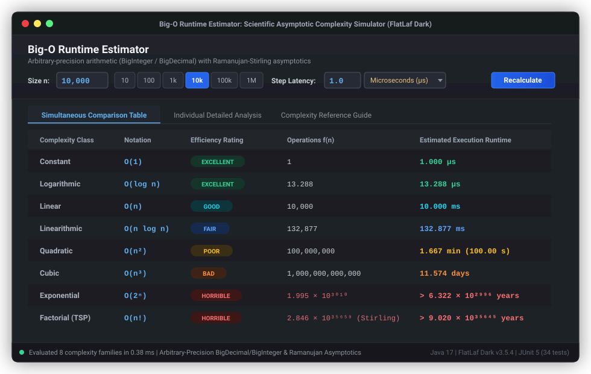

<p align="right">
  <strong>Language:</strong>
  <b>English</b> | <a href="README.es.md">Español</a>
</p>

# Big-O Runtime Estimator

<p align="center">
  
  
  
  
  
</p>

A scientific algorithmic runtime estimation platform engineered in **Java 17+**. Computes execution runtimes across 8 canonical Big-O complexity families using arbitrary-precision arithmetic (`BigInteger`, `BigDecimal`), asymptotic Ramanujan/Stirling approximations, and multi-scale cosmological time formatting. Features a modern **FlatLaf Dark** comparative GUI and an interactive terminal CLI.

<p align="center">
  
</p>

---

## Supported Complexity Taxonomy

Given an input size $n$ and a baseline step execution latency $t_{\text{base}}$:

| Complexity Class | Formal Notation | Growth Formula $f(n)$ | Canonical Example |
| :--- | :---: | :---: | :--- |
| **Constant** | $\mathcal{O}(1)$ | $1$ | Hash table lookup, array index read |
| **Logarithmic** | $\mathcal{O}(\log n)$ | $\log_2(n)$ | Binary search in sorted array |
| **Linear** | $\mathcal{O}(n)$ | $n$ | Single-pass linear scan |
| **Linearithmic** | $\mathcal{O}(n \log n)$ | $n \times \log_2(n)$ | Merge Sort, Quick Sort (average) |
| **Quadratic** | $\mathcal{O}(n^2)$ | $n^2$ | Bubble Sort, nested matrix loops |
| **Cubic** | $\mathcal{O}(n^3)$ | $n^3$ | Naive matrix multiplication |
| **Exponential** | $\mathcal{O}(2^n)$ | $2^n$ | Brute-force subset sum, power set |
| **Factorial** | $\mathcal{O}(n!)$ | $n!$ | Traveling Salesperson Problem (TSP) brute-force |

---

## Core Engineering & Asymptotic Engine

- **Arbitrary-Precision Arithmetic**: Computation runs strictly on decoupled `BigInteger` and `BigDecimal` pipelines (`BigOEngine`), preventing 64-bit integer overflows common with `long` arithmetic.
- **Asymptotic Factorial Approximation (Ramanujan / Stirling)**: For $n > 10{,}000$, exact factorial computation allocates excessive memory. The engine seamlessly applies Stirling's series with Ramanujan's high-order correction to estimate $\log_{10}(n!)$ in $\mathcal{O}(1)$ time:
  $$\ln(n!) \approx n \ln(n) - n + \frac{1}{6} \ln\left(n \left(1 + 4n(1 + 2n)\right)\right) + \frac{1}{2} \ln(\pi)$$
- **Constant-Time Exponential Scaling**: When $n \ge 1{,}000{,}000$, computing $2^n$ directly would require hundreds of megabytes. The engine estimates the exponent via base conversion $\log_{10}(2^n) = n \cdot \log_{10}(2)$ and formats the scientific exponent in $\mathcal{O}(1)$ time.
- **Cosmological Multi-Scale Time Formatter**: Covers continuous ranges from sub-microsecond latencies up to cosmological epochs exceeding the age of the observable universe ($> 13.8\times 10^9\ \text{years}$):
  - Nanoseconds ($\text{ns}$), microseconds ($\mu\text{s}$), milliseconds ($\text{ms}$), seconds ($\text{s}$).
  - Minutes, hours, days, calendar years ($365.25\ \text{days}$).
  - Millennia ($10^3\ \text{yr}$), mega-annum ($10^6\ \text{yr}$), and cosmological scale ($10^9\ \text{yr}$).

---

## Application Interfaces

### 1. Modern Desktop GUI (Swing + FlatLaf Dark)
- Designed with **FlatLaf Dark** theme matching modern developer environments.
- **Live Comparative Table**: Displays all 8 complexity classes simultaneously, auto-updating on every keystroke or slider change.
- **Visual Pill Badges**: Color-coded complexity tags (green for sub-second, yellow for human-interactive time, red for unfeasible exponential times).
- **Interactive Presets**: Quick-select buttons for common problem sizes:
  - $n = 100$ (small input)
  - $n = 10{,}000$ (medium dataset)
  - $n = 1{,}000{,}000$ (large dataset)
  - $n = 10^9$ (big data scale)

### 2. Interactive Terminal CLI
- Fast command-line interface for headless servers or automated scripts.
- Supports individual complexity queries or complete matrix summaries.

---

## Project Structure

```text
Big-O-Runtime-Estimator/
├── pom.xml                                  # Maven build configuration (Java 17, FlatLaf, JUnit 5)
├── README.md                                # Project documentation (English)
├── README.es.md                             # Project documentation (Spanish)
└── src/
    ├── main/java/com/danicaju/bigo/
    │   ├── core/
    │   │   ├── ComplexityClass.java         # 8 canonical complexity families
    │   │   ├── BigOEngine.java              # Arbitrary-precision math & asymptotic algorithms
    │   │   └── TimeFormatter.java           # Multi-scale sub-microsecond to cosmological formatter
    │   ├── cli/
    │   │   └── BigOConsoleApp.java          # Interactive terminal client
    │   └── gui/
    │       └── BigOGuiApp.java              # Swing + FlatLaf Dark simultaneous comparative GUI
    └── test/java/com/danicaju/bigo/
        ├── core/BigOEngineTest.java         # Arithmetic correctness & asymptotic precision tests
        └── core/TimeFormatterTest.java      # Multi-scale formatting & boundary tests
```

---

## Build & Execution

### Prerequisites
- **Java Development Kit (JDK) 17+**
- **Apache Maven 3.8+**

### Compile & Run Tests
```bash
mvn clean test
```

### Launch Desktop GUI
```bash
mvn exec:java -Dexec.mainClass="com.danicaju.bigo.gui.BigOGuiApp"
```

### Launch Interactive CLI
```bash
mvn exec:java -Dexec.mainClass="com.danicaju.bigo.cli.BigOConsoleApp"
```

### Package Standalone Executable Fat JAR
```bash
mvn clean package -DskipTests
```
The runnable fat JAR will be generated in `target/big-o-runtime-estimator-2.0.0.jar`.

---

## Testing & Quality Assurance

The test suite comprises **34 automated unit tests** using JUnit 5:
- **Mathematical Accuracy**: Validates exact operation counts across all 8 classes for small and large $n$.
- **Asymptotic Approximations**: Validates Stirling/Ramanujan factorial scaling against exact big integer multiplication within $< 0.1\%$ margin.
- **Extreme Scale Invariants**: Ensures $n = 10^{18}$ and $2^{1{,}000{,}000}$ execute without throwing `ArithmeticException` or `OutOfMemoryError`.
- **Time Formatting**: Tests fractional units, cosmological boundaries, and scientific notation rendering.

```text
[INFO] Running com.danicaju.bigo.core.BigOEngineTest
[INFO] Tests run: 20, Failures: 0, Errors: 0, Skipped: 0
[INFO] Running com.danicaju.bigo.core.TimeFormatterTest
[INFO] Tests run: 14, Failures: 0, Errors: 0, Skipped: 0
[INFO]
[INFO] Results:
[INFO] Tests run: 34, Failures: 0, Errors: 0, Skipped: 0
```

---

<p align="center">
  <sub>Developed by <b>Daniel Casado Juan</b> | Universitat de les Illes Balears (UIB)</sub>
</p>
