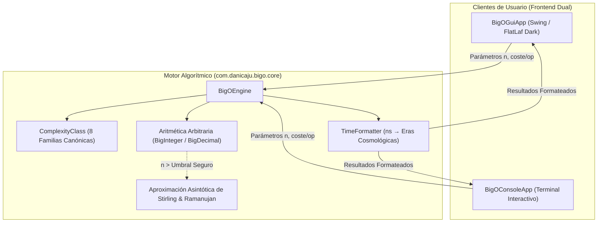

# Big-O Runtime Estimator

<p align="center">
  
  
  
  
  
  
</p>

Simulador de complejidad algorítmica y calculadora de tiempo de ejecución teórico desarrollado en **Java 17+**. Evalúa el crecimiento asintótico de funciones algorítmicas frente a conjuntos de datos arbitrarios ($n$). 

Incorpora un motor matemático de precisión arbitraria basado en **BigInteger** y **BigDecimal** inmune a desbordamientos de 64 bits en funciones exponenciales ($2^n$) y factoriales ($n!$), un formateador temporal capaz de traducir duraciones desde nanosegundos hasta eras cosmológicas ($> 13.8\ \text{Ga}$), y un **doble frontend**: una interfaz gráfica moderna en **Swing** con tema **FlatLaf Dark** y un cliente de terminal interactivo (**CLI**).

---

## Arquitectura del Sistema



---

## Jerarquía y Tabla Comparativa de Complejidades

La aplicación evalúa simultáneamente las 8 clases canónicas de complejidad asintótica en orden estricto de eficiencia:

$$\mathcal{O}(1) < \mathcal{O}(\log n) < \mathcal{O}(n) < \mathcal{O}(n \log n) < \mathcal{O}(n^2) < \mathcal{O}(n^3) < \mathcal{O}(2^n) < \mathcal{O}(n!)$$

A continuación se ilustra el comportamiento para una entrada de muestra $n = 100$ asumiendo un procesador con coste atómico de $1\ \mu\text{s}$ por operación ($0.001\ \text{ms}$):

| Notación | LaTeX | Nombre | Eficiencia | Operaciones $f(n)$ | Tiempo Estimado | Algoritmos Representativos |
| :--- | :--- | :--- | :---: | :---: | :---: | :--- |
| **O(1)** | `\mathcal{O}(1)` | Constante | **Excelente** | $1$ | $1.000\ \mu\text{s}$ | Acceso indexado en arrays, push/pop en pila, hash lookups promedio. |
| **O(log n)** | `\mathcal{O}(\log n)` | Logarítmica | **Excelente** | $6.64$ | $6.644\ \mu\text{s}$ | Búsqueda binaria, árboles balanceados (AVL, Red-Black), binary heaps. |
| **O(n)** | `\mathcal{O}(n)` | Lineal | **Bueno** | $100$ | $100.000\ \mu\text{s}$ | Búsqueda lineal, suma o filtrado en arrays, recorrido secuencial. |
| **O(n log n)** | `\mathcal{O}(n \log n)` | Linealítmica | **Aceptable** | $664.39$ | $664.386\ \mu\text{s}$ | Merge Sort, Quick Sort (caso promedio), Heap Sort, TimSort. |
| **O(n²)** | `\mathcal{O}(n^2)` | Cuadrática | **Malo** | $10,000$ | $10.000\ \text{ms}$ | Bubble Sort, Selection Sort, comparación de todos los pares. |
| **O(n³)** | `\mathcal{O}(n^3)` | Cúbica | **Malo** | $1,000,000$ | $1.000\ \text{s}$ | Multiplicación estándar de matrices, algoritmo de Floyd-Warshall. |
| **O(2ⁿ)** | `\mathcal{O}(2^n)` | Exponencial | **Horrible** | $\approx 1.27 \times 10^{30}$ | $4.02 \times 10^{16}$ años | Fibonacci ingenuo sin memoización, generación de subconjuntos. |
| **O(n!)** | `\mathcal{O}(n!)` | Factorial | **Horrible** | $\approx 9.33 \times 10^{157}$ | $2.96 \times 10^{144}$ años | Problema del Viajante de Comercio (TSP) por fuerza bruta, permutaciones. |

---

## Características Principales

### 1. Motor Aritmético de Precisión Arbitraria
- **Resistencia a Overflow**: Los tipos primitivos estándar de Java (`long`, `double`) sufren desbordamiento en $2^{64}$ y pierden precisión a partir de $170!$. El motor `BigOEngine` emplea `BigInteger` y `BigDecimal` garantizando exactitud matemática total.
- **Régimen Asintótico Seguro**: Para entradas masivas (ej. $n > 10,000$ en $2^n$ o $n > 5,000$ en $n!$), el motor conmuta automáticamente a aproximaciones asintóticas basadas en las fórmulas de Stirling y logaritmos decimales, evitando el consumo indebido de memoria heap (`OutOfMemoryError`).

### 2. Formateador Temporal Multiescala (`TimeFormatter`)
Convierte dinámicamente cualquier lapso temporal a la unidad humana más intuitiva:
- **Sub-segundo**: Nanosegundos ($\text{ns}$), Microsegundos ($\mu\text{s}$), Milisegundos ($\text{ms}$).
- **Humano**: Segundos ($\text{s}$), Minutos con segundos, Horas con minutos, Días, Semanas.
- **Histórico**: Años, Siglos.
- **Cosmológico**: Múltiplos astronómicos de la edad estimada del Universo observable ($13.8\ \text{Ga} \approx 4.35 \times 10^{17}\ \text{segundos}$), con notación científica en superíndices Unicode (ej. $1.42 \times 10^{18}\ \text{años}$).

### 3. Interfaz Gráfica FlatLaf Dark (`BigOGuiApp`)
- **Tabla Comparativa Simultánea**: Renderizado en tiempo real de las 8 complejidades para un $n$ y tiempo/op determinados.
- **Pill Badges de Eficiencia**: Etiquetas coloreadas según la escala cualitativa (Verde = Excelente, Verde Lima = Bueno, Ámbar = Aceptable, Naranja = Malo, Rojo = Horrible).
- **Selector Rápido de Presets**: Acceso instantáneo a tamaños de muestra comunes ($10$, $100$, $1\text{k}$, $10\text{k}$, $100\text{k}$, $1\text{M}$).
- **Panel de Inspección Individual**: Pestaña dedicada con detalles teóricos, notación LaTeX y ejemplos reales de la industria.
- **Exportación**: Copia instantánea del resumen comparativo al portapapeles del sistema operativo.

### 4. Cliente de Terminal Interactivo (`BigOConsoleApp`)
- Interfaz CLI estructurada con menús interactivos, soporte para visualización de tabla tabular y selector de complejidades individuales.

---

## Estructura del Repositorio

```
Big-O-Runtime-Estimator/
├── pom.xml                                   # Configuración de compilación Maven y plugins
├── README.md                                 # Documentación técnica completa
├── LICENSE                                   # Licencia MIT
└── src/
    ├── main/java/com/danicaju/bigo/
    │   ├── cli/
    │   │   └── BigOConsoleApp.java           # Cliente de terminal interactivo
    │   ├── core/
    │   │   ├── BigOEngine.java               # Motor de cálculo y aproximaciones asintóticas
    │   │   ├── ComplexityCalculator.java     # Fachada estática de cálculo algorítmico
    │   │   ├── ComplexityClass.java          # Enum canónico de las 8 familias Big-O
    │   │   ├── ComplexityResult.java         # Contenedor inmutable de resultados
    │   │   ├── EfficiencyLevel.java          # Niveles de eficiencia cualitativos y colores
    │   │   ├── TimeFormatter.java            # Formateador temporal inteligente y notación Unicode
    │   │   └── TimeUnit.java                 # Unidades de tiempo (ns, µs, ms, s)
    │   └── ui/
    │       └── BigOGuiApp.java               # Frontend Swing con FlatLaf Dark
    └── test/java/com/danicaju/bigo/core/
        ├── BigOEngineTest.java               # Suite JUnit 5 del motor algorítmico
        ├── ComplexityClassTest.java          # Pruebas de metadatos de complejidad
        ├── TimeFormatterTest.java            # Pruebas de formateo multiescala
        └── TimeUnitConverterTest.java        # Pruebas de conversión de unidades
```

---

## Requisitos del Sistema

- **Java Development Kit (JDK)**: Versión 17 o superior.
- **Apache Maven**: Versión 3.8+ o 3.9+.

---

## Compilación y Ejecución

### 1. Compilación y Suite de Tests
Para compilar el proyecto y ejecutar la suite completa de pruebas unitarias en JUnit 5:

```bash
mvn clean test
```

Para generar el Uber-JAR ejecutable autocontenido con dependencias empaquetadas:

```bash
mvn clean package
```
El artefacto resultante se ubicará en `target/big-o-runtime-estimator-1.0.0.jar`.

### 2. Ejecutar la Interfaz Gráfica (GUI)

Vía Maven:
```bash
mvn exec:java@gui
```

O directamente mediante el Uber-JAR generado:
```bash
java -jar target/big-o-runtime-estimator-1.0.0.jar
```

### 3. Ejecutar el Cliente de Terminal (CLI)

Vía Maven:
```bash
mvn exec:java@cli
```

O mediante `java`:
```bash
java -cp target/big-o-runtime-estimator-1.0.0.jar com.danicaju.bigo.cli.BigOConsoleApp
```

---

## Licencia

Distribuido bajo la licencia **MIT**. Consulte el archivo [LICENSE](LICENSE) para más información.
